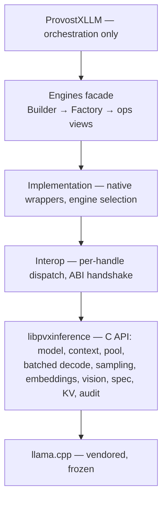

# ProvostXInference

C/C++ inference engine + C# bindings for ProvostX — a llama.cpp-only, GGUF-only execution
substrate behind a strict-OOP C# facade. Replaces LLamaSharp entirely.

  

## Why this repo

- **Full control of the native seam** — llama.cpp linked directly behind a flat C API; batching, KV cache, vision, speculative decoding and backend safety are ours, not a wrapper's.
- **Fail-closed everywhere** — typed errors with named boundaries; unknown capabilities refuse, they never silently degrade. ABI version handshake at load; struct layouts test-pinned.
- **Per-engine observability** — each engine instance can carry its own JSON-lines audit trail and model-wide telemetry snapshot; zero cost when unconfigured.

## Features

| Area | What you get | Key types |
|---|---|---|
| Model loading | GGUF, GPU layers, flash attention, KV quant (F16/Q8_0/Q4_0) | `ModelConfig`, `NativeInferenceModel` |
| Generation | Prompt → infer → sample loop, full sampling pipeline (wave-5 verbs: dry, xtc, top-n-sigma, mirostat) | `IStandardExecutor`, `SamplingConfig` |
| Batched | 4+ conversations in ONE decode; pre-allocated pool, lease/return with KV cleanup | `IConversationPool`, `IConversation` |
| Vision | mmproj + image prompt splice (MTMD) | `IVisionEncoder` |
| Embeddings | mean/CLS/last pooling; encoder models (MiniLM/BERT) routed by architecture | `GetEmbeddings` |
| Speculative | draft-simple, n-gram family, EAGLE3, draft-MTP (incl. multi-block chain heads) | `SpeculativeConfig` |
| Audio / TTS | audio input (PCM F32), speech output on gen-audio pipelines | `PromptWithAudio`, `ITtsSession` |
| Rerank / LoRA / cvec | single-shot rerank; live LoRA attach; control vectors | `Rerank`, `SetAdapters` |
| Audit + telemetry | per-engine JSON-lines audit trail; model-wide counters; zero-cost when off | `ModelConfig.AuditPath`, `GetEngineTelemetry()` |
| Grammar | GBNF + JSON-schema→GBNF converter; tiered rejection sampling | `CreateGrammar`, `CreateGrammarFromJsonSchema` |

## Quickstart

Native library (macOS Metal example; see CI matrix for Linux/Windows backends):

```bash
git submodule update --init --recursive
cmake -B build-metal -DPVX_BACKEND_METAL=ON -DCMAKE_BUILD_TYPE=Release
cmake --build build-metal -j
ctest --test-dir build-metal --output-on-failure   # model-gated legs skip without models
```

C# bindings (stage the built dylib where the resolver looks):

```bash
mkdir -p csharp/runtimes/osx-arm64/native
cp build-metal/libpvxinference.dylib csharp/runtimes/osx-arm64/native/
cd csharp
dotnet test Tests/    # 252 tests; live lanes skip typed when no model fixture is present
```

Minimal consumer code (from the verified consumer harness):

```csharp
var engine = InferenceEngineBuilder.Gguf(modelPath).Build();
engine.Initialize();
var exec = engine.Gguf.CreateExecutor();
exec.Prompt("The capital of France is");
exec.Infer();
var token = exec.Sample(new SamplingConfig { Temperature = 0.3f });
```

## Backend / capability matrix

| RID slice | Specialist | Built by |
|---|---|---|
| osx-arm64 | metal (+ generic cpu) | CI |
| win-arm64 | cpu (generic payload) | CI |
| win-x64 | cuda + vulkan | CI |
| linux-x64 | cuda + vulkan | CI |
| linux-arm64 | source-build + ORT | documented path |

No native binaries are checked in — CI builds every slice at pack time (keeps
compiler-baked build paths out of the repository). The managed resolver picks the
specialist for the host OS; the cpu specialist falls back to the generic payload name.

## Architecture



Details: [ARCHITECTURE.md](ARCHITECTURE.md) · Consumer contract: [CONTRACT.md](CONTRACT.md)

## Documentation

| Document | Content |
|---|---|
| [CONTRACT.md](CONTRACT.md) | Consumer contract — what you may touch, what is guaranteed |
| [ARCHITECTURE.md](ARCHITECTURE.md) | As-is architecture, all layers, ABI waves |
| [docs/CAPABILITY.md](docs/CAPABILITY.md) | Capability matrix + careful-handling areas |
| [docs/CONFIGURATION.md](docs/CONFIGURATION.md) | Configuration reference |
| [GETTING-STARTED.md](GETTING-STARTED.md) | Getting started |
| [docs/api-glossary.md](docs/api-glossary.md) | Every public type explained |
| [docs/faq.md](docs/faq.md) | Frequently asked questions |
| [TEST-MATRIX-2026-10-18.md](TEST-MATRIX-2026-10-18.md) | Real-model verification matrix |

## License

MIT — see [LICENSE](LICENSE). Third-party notices: [THIRD-PARTY-NOTICES.md](THIRD-PARTY-NOTICES.md)
(llama.cpp, ONNX Runtime, and the corporate design dependencies).
